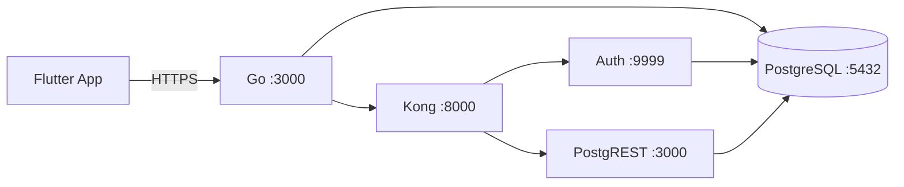

# Refer API — Backend Go + Supabase

Backend de [[Refer - Idea de Negocio|Refer]] (Flutter sin cambios): `Flutter → Go API → Supabase Auth + Supabase PostgreSQL`. Go es el único que habla con Supabase; Flutter usa el mismo contrato `/api/*` de siempre.

> [!abstract] Ficha rápida
> - **Repo:** `refer_api` · **Lenguaje:** Go 1.25 · **Framework:** Fiber v2 + Bun ORM
> - **API base local:** `http://localhost:3001` (container) / `:3000` (`go run`)
> - **DB principal:** Supabase PostgreSQL (`supabase-db:5432`, host `localhost:5433`)
> - **Auth:** Supabase Auth nativo (GoTrue); sin SUPABASE_* el server no arranca
> - **Health:** `GET /health` → `{"status":"ok"}`

## 1. Stack y dependencias

| Capa | Qué usamos | Detalle |
|---|---|---|
| HTTP | `gofiber/fiber/v2` v2.52.13 | Router + CORS + static `/uploads` y `/templates` |
| ORM | `uptrace/bun` v1.2.18 + `pgdialect` + `pgdriver` | Modelos en `models/`, repos en `repository/` |
| Auth JWT | `golang-jwt/jwt/v5` | Supabase (`SUPABASE_JWT_SECRET`), sub = auth.users.id |
| Passwords | GoTrue | Las gestiona Supabase Auth; en DB no se guardan hashes |
| Realtime carrito | `zishang520/socket.io/v2` | Gateway en `gateway/socket_gateway.go`, ruta `/socket.io/*` |
| Pagos | `stripe/stripe-go/v72` | `POST /api/payments/create-payment-intent` |
| Config | `joho/godotenv` | Carga `.env` (gitignored, copiar de `.env.example`) |
| Infra | Docker Compose + Supabase self-hosted | PG 15.8.1.060, Auth v2.196.0, PostgREST v12.2.0, Kong 2.8.1, Storage v1.73.0 |



## 2. Servicios Docker (`docker-compose.yml`)

| Servicio | Imagen | Puerto host | Notas |
|---|---|---|---|
| `app` (Go) | build local | `${HOST_PORT:-3001}` → 3000 | `DATABASE_URL` interna apunta a `supabase-db` |
| `supabase-db` | `supabase/postgres:15.8.1.060` | `${SUPABASE_DB_EXTERNAL_PORT:-5433}` → 5432 | Volumen `supabase_db_data` — no borrar sin backup |
| `supabase-auth` | `supabase/auth:v2.196.0` | interno :9999 vía Kong `/auth/v1/*` | OTP 6 dígitos, Resend SMTP |
| `supabase-rest` | `postgrest/postgrest:v12.2.0` | interno :3000 vía Kong `/rest/v1/*` | Denegado por RLS deny-all; solo Go autoriza |
| `supabase-kong` | `kong:2.8.1` | `:8000` / `:8443` | Config `supabase/kong.yml`, DB-less |
| `supabase-storage` | `supabase/storage-api:v1.73.0` | interno :5000 vía Kong `/storage/v1/*` | Buckets `products` / `avatars`, volumen `supabase_storage_data` |

## 3. Variables de entorno (`.env`)

| Var | Para qué |
|---|---|
| `PORT` / `HOST_PORT` | Puerto Go (`3000` / `3001`) |
| `DATABASE_URL` | **DB principal** Supabase PG. Prioridad sobre `DB_*` |
| `APP_DATABASE_URL` | Override de `DATABASE_URL` dentro del compose (red interna) |
| `DB_HOST…DB_NAME` | PG Supabase (ver `DATABASE_URL`) |
| `ADMIN_EMAIL` / `ADMIN_PASSWORD` | Seed del admin (aprovisionado en Supabase Auth al arrancar) |
| `SUPABASE_URL` | Auth para Go: compose `http://supabase-kong:8000`, local `http://localhost:8000` |
| `SUPABASE_ANON_KEY` / `SUPABASE_SERVICE_ROLE_KEY` | anon (Go) / admin — **solo servidor, jamás Flutter/Git** |
| `SUPABASE_JWT_SECRET` | Firma JWT Supabase (≥32 chars) |
| `SUPABASE_POSTGRES_PASSWORD` | Password `postgres`/`authenticator` (solo letras/números) |
| `SUPABASE_PUBLIC_URL` / `SUPABASE_SITE_URL` | Links email Auth / redirects |
| `GOTRUE_JWT_EXP` / `SUPABASE_MAILER_AUTOCONFIRM` | `3600` / `false` exige OTP |
| `SUPABASE_MAILER_OTP_EXP` | `600` (10 min) expiración código OTP |
| `SMTP_*` (Resend) | `smtp.resend.com`, `SMTP_USER=resend`, `SMTP_PASS=re_...` |
| `STRIPE_SECRET_KEY` | `sk_test_...` para PaymentIntents |
| `APP_VERSION` / `APP_MIN_VERSION` | `GET /config` → Flutter fuerza/sugiere update |
| `CORS_ORIGINS` | `localhost:4200, refer.cobyzero.com, refer-api.cobyzero.com` |

> [!danger] Secretos
> `SERVICE_ROLE_KEY`, `SUPABASE_JWT_SECRET`, `SMTP_PASS`, `STRIPE_SECRET_KEY` nunca van a Git, Flutter, respuestas ni logs. `.env` está en `.gitignore`.

## 4. Endpoints — contrato Flutter (`routes/`)

Base: `/api/*`. Prefijo `🔒` = requiere JWT. `👑` = requiere rol `ADMIN`.

### Auth — `routes/auth_routes.go`

| Método | Ruta | Notas |
|---|---|---|
| POST | `/api/auth/register` | `201 {user, needsVerification:true}` + email OTP 6 dígitos |
| POST | `/api/auth/verify-email` | `{email, code}` → `200 {user, accessToken, refreshToken}` |
| POST | `/api/auth/resend-verification` | Reenvía código (rate-limit GoTrue) |
| POST | `/api/auth/login` | No verificada → `403 {code: EMAIL_NOT_VERIFIED}` (no 401, para que Flutter abra OTP) |
| POST | `/api/auth/forgot-password` | Envía recovery vía Auth |
| POST | `/api/auth/reset-password` | Define nueva password |
| POST | `/api/auth/refresh` | Renueva tokens |
| POST | `/api/auth/logout` | Invalida sesión |
| POST 🔒 | `/api/auth/change-password` | Cambio con sesión |
| GET 🔒 | `/api/auth/validate` | Valida JWT Supabase |
| GET 🔒 | `/api/auth/me` | Usuario actual |

### Users — `routes/user_routes.go`

| Método | Ruta |
|---|---|
| GET 🔒 | `/api/users/profile` |
| PATCH 🔒 | `/api/users/profile` |
| POST 🔒 | `/api/users/upload` → `201 {photoUrl}` (multipart `file`, Storage `avatars` o disco `./uploads`) |
| GET 👑 | `/api/users/` |
| GET 👑 | `/api/users/:id` |
| POST 👑 | `/api/users/` |
| PATCH 👑 | `/api/users/:id` |
| DELETE 👑 | `/api/users/:id` |

### Products — `routes/product_routes.go`

Públicos: `GET /api/products/` · `/top-rated` · `/seasonal` (contrato móvil, intacto) · `/categories` · `/sizes` · `/types` · `/enhancements` · `/:id`. Admin/modificación: `POST /` · `PATCH /:id` · `POST /upload` → `201 {imageUrl}` (bucket `products`) · CRUD `/categories/:id`, `/sizes/:id`, asignar `/:id/sizes`, `/:id/types`, `/:id/enhancements`.

### Collections — `routes/collection_routes.go`

`GET /api/collections/` · `POST /` · `PATCH /:id` · `DELETE /:id` · `POST /:id/items` · `DELETE /:id/items/:productId`.

### Stars / Perks — `routes/star_routes.go`

| Método | Ruta |
|---|---|
| GET 🔒 | `/api/stars/balance` · `/history` · `/rewards` · `/redeemed` |
| POST 🔒 | `/api/stars/redeem` |
| GET 👑 | `/api/stars/transactions` |
| POST/PATCH/DELETE 👑 | `/api/stars/rewards` · `/rewards/:id` |
| GET público | `/api/perks` |

### Órdenes / Pagos / Carrito

| Método | Ruta |
|---|---|
| POST 🔒 | `/api/orders/` |
| GET 🔒 | `/api/orders/` |
| PATCH 👑 | `/api/orders/:id/status` |
| POST 🔒 | `/api/payments/create-payment-intent` (Stripe) |
| Socket.io | `/socket.io/*` eventos carrito: `add` / `remove` / `quantity` / `clear` (también auditan) |

### Dashboard / Search / Config / Locations / Audit

| Método | Ruta |
|---|---|
| GET 🔒 | `/api/dashboard/summary` |
| GET 👑 | `/api/dashboard/admin/summary` |
| GET | `/api/search/referrals` · `/api/search/categories` |
| GET | `/api/config` → `{version, minVersion}` (`APP_VERSION`/`APP_MIN_VERSION`) |
| PUT | `/api/config` |
| GET | `/api/locations/` (solo activas) · `/api/locations/:id` |
| GET | `/api/locations/admin/all` |
| POST/PATCH/DELETE | `/api/locations/` · `/:id` |
| GET 👑 | `/api/audit-logs/?userId&action&q&entityType&entityId&from&to&page&limit` → `{data, total, page, limit}` |
| GET 👑 | `/api/audit-logs/actions` (filtros dropdown refer_web) |
| GET | `/health` → `{"status":"ok"}` (fuera de `/api`) |

## 5. Modelos y tablas (`models/` + `database/`)

20 tablas migradas (`users`, `orders`, `products`, …). Modelos Bun en:

- `user.go` (+ `users_roles`, join `UserRole` registrado en `main.go`)
- `product.go` (categorías, sizes, types, enhancements)
- `order.go` · `cart.go` (join `CartItemEnhancement`) · `star.go` (balance, history, rewards, redeemed)
- `location.go` · `app_setting.go` (config/version) · `role.go` · `dashboard.go` · `audit_log.go`
- `auth.users.id == public.users.id` (UUID preservado; remap con cascada en `orders`, `star_transactions`, `redeemed_rewards`, `cart_items`, `users_roles` si Auth ignora el id)

Seguridad/RLS (`supabase/rls.sql`): RLS habilitado en las 20 tablas **sin policies permisivas** → PostgREST directo denegado. Toda autorización vive en Go (JWT Supabase + `RequireRole("ADMIN")`). Aplicar una vez por entorno tras el primer arranque: `make supabase-rls`.

## 6. Auth — flujo OTP (Supabase Auth nativo + Resend)

1. `POST /api/auth/register` → `201 {user, needsVerification:true}` (sin tokens) + email con código 6 dígitos.
2. `POST /api/auth/verify-email {email, code}` → `200 {user, accessToken, refreshToken}`.
3. `POST /api/auth/resend-verification {email}` → reenvía (rate-limit GoTrue).
4. `POST /api/auth/login` sin verificar → `403 EMAIL_NOT_VERIFIED`. ^flujo-otp

Requiere `SUPABASE_MAILER_AUTOCONFIRM=false` + SMTP Resend válido. Plantilla en `supabase/templates/confirmation.html` (usa `{{ .Token }}`); Go la sirve en `/templates` y GoTrue la descarga por HTTP (`GOTRUE_MAILER_TEMPLATES_CONFIRMATION`).

JWT Supabase (`middleware/jwt.go`): se valida contra `SUPABASE_JWT_SECRET`; roles enriquecidos desde `public.users`.

## 7. Uploads — Supabase Storage

`POST /api/products/upload` y `POST /api/users/upload` reciben multipart `file` y responden igual que siempre. Go guarda en Storage (buckets `products`/`avatars`, lectura pública) con fallback a disco `./uploads`. URLs nuevas: `<public-url>/storage/v1/object/public/<bucket>/<file>`.

```bash
make supabase-storage-init  # buckets + policy (una vez por entorno)
```

## 8. Auditoría (módulo admin de refer_web)

Toda mutación `POST/PUT/PATCH/DELETE` en `/api/*` → tabla `audit_logs`: actor (JWT), acción, entidad, status, IP, detalle. Sockets del carrito también. Lecturas no se loguean. Acciones ricas: `auth.register|login(.failed)|forgot|reset|password`, `order.create|status`, `user.*`, `product.*`, `reward.*`, `collection.*`, `location.*`, `config.update`, `payment.intent`, `cart.*`; resto `METHOD /ruta`. Nunca passwords/secrets. Middleware en `middleware/audit.go`, servicio `services/audit_service.go`.

## 9. Comandos útiles (`Makefile` + `scripts/`)

```bash
cp .env.example .env && docker compose up -d --wait && docker compose ps
curl http://localhost:3001/health
curl http://localhost:8000/auth/v1/health

make dev              # hot reload local con air
make dev-docker       # compose watch
make build / make run
make supabase-up      # PG + Auth + REST + Kong
make supabase-psql    # psql con DATABASE_URL
make supabase-rls     # RLS deny-all (una vez por entorno, tras el primer arranque)
make supabase-storage-init
```

## 10. Estructura del repo

```
main.go                  # bootstrap: DB, migrate, EnsureAdmin, servicios, Fiber, /api
handlers/  services/  repository/  routes/  # 12 módulos: auth, users, products, collections,
                                             # stars, dashboard, search, config, locations,
                                             # payments, orders, audit
models/  middleware/ (jwt, audit)  gateway/ (socket.io carrito)
database/ (connect, migrate, seed admin@admin.com)
supabase/ (kong.yml, rls.sql, storage.sql, templates/, init/)
uploads/  public/
Dockerfile (multi-stage Go 1.25 → alpine, non-root appuser)
```

## Referencias

- Kong: http://localhost:8000 · Kong Auth health: http://localhost:8000/auth/v1/health
- Ver también: [[Refer - Idea de Negocio]] ^referencias

> [!todo] Pendientes / vigilar
> - [ ] Rotar secrets de dev en prod (`openssl rand -hex 16` / `-base64 48`, re-firmar ANON/SERVICE_ROLE HS256 `iss: supabase-demo`)
