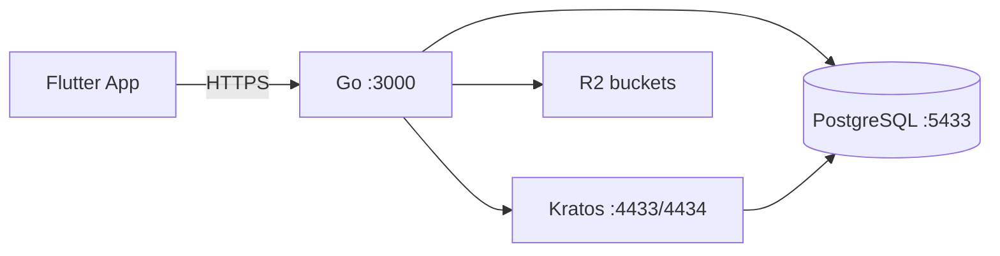

# Refer API — Backend Go + Kratos + R2

Backend de [[Refer - Idea de Negocio|Refer]] (Flutter sin cambios): `Flutter → Go API → Kratos + PostgreSQL + R2`. Go es el único que habla con Kratos/R2; Flutter usa el mismo contrato `/api/*` de siempre.

> [!abstract] Ficha rápida
> - **Repo:** `refer_api` · **Lenguaje:** Go 1.25 · **Framework:** Fiber v2 + Bun ORM
> - **API base local:** `http://localhost:3001` (container) / `:3000` (`go run`)
> - **DB principal:** PostgreSQL externa (`149.202.62.87:5433`, proyecto `refer-db`)
> - **Auth:** Ory Kratos self-hosted (argon2 + OTP 6 dígitos); sin KRATOS_* + AUTH_JWT_SECRET el server no arranca
> - **Health:** `GET /health` → `{"status":"ok"}`

## 1. Stack y dependencias

| Capa | Qué usamos | Detalle |
|---|---|---|
| HTTP | `gofiber/fiber/v2` v2.52.13 | Router + CORS + static `/uploads` |
| ORM | `uptrace/bun` v1.2.18 + `pgdialect` + `pgdriver` | Modelos en `models/`, repos en `repository/` |
| Auth JWT | `golang-jwt/jwt/v5` | API JWT HS256 (`AUTH_JWT_SECRET`), sub = Kratos identity id |
| Passwords | Ory Kratos (argon2) | Las gestiona Kratos; en DB no se guardan hashes |
| Realtime carrito | `zishang520/socket.io/v2` | Gateway en `gateway/socket_gateway.go`, ruta `/socket.io/*` |
| Storage | `aws/aws-sdk-go-v2/service/s3` | R2 S3-compatible + fallback disco `./uploads` |
| Pagos | `stripe/stripe-go/v72` | `POST /api/payments/create-payment-intent` |
| Config | `joho/godotenv` | Carga `.env` (gitignored, copiar de `.env.example`) |
| Infra | Docker Compose + PG externa | Kratos v26.2.0, PG proyecto `refer-db`, R2 |



## 2. Servicios Docker (`docker-compose.yml`)

| Servicio | Imagen | Puerto host | Notas |
|---|---|---|---|
| `app` (Go) | build local | `${HOST_PORT:-3001}` → 3000 | `DATABASE_URL` apunta a PG externa |
| `kratos-migrate` | `oryd/kratos:v26.2.0` | — | one-shot: migra y sale |
| `kratos` | `oryd/kratos:v26.2.0` | `127.0.0.1:4433` → 4433, `127.0.0.1:4434` → 4434 | OTP 6 dígitos, Resend SMTP |

## 3. Variables de entorno (`.env`)

| Var | Para qué |
|---|---|
| `PORT` / `HOST_PORT` | Puerto Go (`3000` / `3001`) |
| `DATABASE_URL` | **DB principal** PG externa. Prioridad sobre `DB_*` |
| `APP_DATABASE_URL` | Override de `DATABASE_URL` dentro del compose |
| `DB_HOST…DB_NAME` | PG externa (ver `DATABASE_URL`) |
| `ADMIN_EMAIL` / `ADMIN_PASSWORD` | Seed del admin (aprovisionado en Kratos al arrancar) |
| `KRATOS_PUBLIC_URL` / `KRATOS_ADMIN_URL` | Kratos para Go: compose `http://kratos:4433/4434`, local `http://localhost:4433/4434` |
| `AUTH_JWT_SECRET` | Firma JWT API (≥32 chars) |
| `AUTH_JWT_EXP_SEC` / `AUTH_REFRESH_TTL_DAYS` | `3600` / `30` |
| `KRATOS_SECRETS_CIPHER` / `KRATOS_SECRETS_COOKIE` | Secretos Kratos |
| `KRATOS_SMTP_URI` | SMTP courier Kratos (Resend). Vacío = envíos dan 503 |
| `R2_ENDPOINT` / `R2_ACCESS_KEY_ID` / `R2_SECRET_ACCESS_KEY` | Cloudflare R2 (S3-compatible) |
| `R2_PUBLIC_*_URL` | Base pública por bucket (`uploads/products/avatars`) |
| `SMTP_*` (Resend) | Referencia para armar `KRATOS_SMTP_URI` |
| `STRIPE_SECRET_KEY` | `sk_test_...` para PaymentIntents |
| `APP_VERSION` / `APP_MIN_VERSION` | `GET /config` → Flutter fuerza/sugiere update |
| `CORS_ORIGINS` | `localhost:4200, refer.cobyzero.com, refer-api.cobyzero.com` |

> [!danger] Secretos
> `AUTH_JWT_SECRET`, `KRATOS_SECRETS_*`, `R2_SECRET_ACCESS_KEY`, `SMTP_PASS`, `STRIPE_SECRET_KEY` nunca van a Git, Flutter, respuestas ni logs. `.env` está en `.gitignore`.

## 4. Endpoints — contrato Flutter (`routes/`)

Base: `/api/*`. Prefijo `🔒` = requiere JWT. `👑` = requiere rol `ADMIN`.

### Auth — `routes/auth_routes.go`

| Método | Ruta | Notas |
|---|---|---|
| POST | `/api/auth/register` | `201 {user, needsVerification:true}` + email OTP 6 dígitos |
| POST | `/api/auth/verify-email` | `{email, code}` → `200 {user, accessToken, refreshToken}` |
| POST | `/api/auth/resend-verification` | Reenvía código |
| POST | `/api/auth/login` | No verificada → `403 {code: EMAIL_NOT_VERIFIED}` (no 401, para que Flutter abra OTP) |
| POST | `/api/auth/forgot-password` | Envía recovery vía Auth |
| POST | `/api/auth/reset-password` | Define nueva password |
| POST | `/api/auth/refresh` | Renueva tokens |
| POST | `/api/auth/logout` | Invalida sesión |
| POST 🔒 | `/api/auth/change-password` | Cambio con sesión |
| GET 🔒 | `/api/auth/validate` | Valida JWT API |
| GET 🔒 | `/api/auth/me` | Usuario actual |

### Users — `routes/user_routes.go`

| Método | Ruta |
|---|---|
| GET 🔒 | `/api/users/profile` |
| PATCH 🔒 | `/api/users/profile` |
| POST 🔒 | `/api/users/upload` → `201 {photoUrl}` (multipart `file`, Storage `avatars` o disco `./uploads`) |
| GET 👑 | `/api/users/` |
| GET 👑 | `/api/users/:id` |
| POST 👑 | `/api/users/` |
| PATCH 👑 | `/api/users/:id` |
| DELETE 👑 | `/api/users/:id` |

### Products — `routes/product_routes.go`

Públicos: `GET /api/products/` · `/top-rated` · `/seasonal` (contrato móvil, intacto) · `/categories` · `/sizes` · `/types` · `/enhancements` · `/:id`. Admin/modificación: `POST /` · `PATCH /:id` · `POST /upload` → `201 {imageUrl}` (bucket `products`) · CRUD `/categories/:id`, `/sizes/:id`, asignar `/:id/sizes`, `/:id/types`, `/:id/enhancements`.

### Collections — `routes/collection_routes.go`

`GET /api/collections/` · `POST /` · `PATCH /:id` · `DELETE /:id` · `POST /:id/items` · `DELETE /:id/items/:productId`.

### Stars / Perks — `routes/star_routes.go`

| Método | Ruta |
|---|---|
| GET 🔒 | `/api/stars/balance` · `/history` · `/rewards` · `/redeemed` |
| POST 🔒 | `/api/stars/redeem` |
| GET 👑 | `/api/stars/transactions` |
| POST/PATCH/DELETE 👑 | `/api/stars/rewards` · `/rewards/:id` |
| GET público | `/api/perks` |

### Órdenes / Pagos / Carrito

| Método | Ruta |
|---|---|
| POST 🔒 | `/api/orders/` |
| GET 🔒 | `/api/orders/` |
| PATCH 👑 | `/api/orders/:id/status` |
| POST 🔒 | `/api/payments/create-payment-intent` (Stripe) |
| Socket.io | `/socket.io/*` eventos carrito: `add` / `remove` / `quantity` / `clear` (también auditan) |

### Dashboard / Search / Config / Locations / Audit

| Método | Ruta |
|---|---|
| GET 🔒 | `/api/dashboard/summary` |
| GET 👑 | `/api/dashboard/admin/summary` |
| GET | `/api/search/referrals` · `/api/search/categories` |
| GET | `/api/config` → `{version, minVersion}` (`APP_VERSION`/`APP_MIN_VERSION`) |
| PUT | `/api/config` |
| GET | `/api/locations/` (solo activas) · `/api/locations/:id` |
| GET | `/api/locations/admin/all` |
| POST/PATCH/DELETE | `/api/locations/` · `/:id` |
| GET 👑 | `/api/audit-logs/?userId&action&q&entityType&entityId&from&to&page&limit` → `{data, total, page, limit}` |
| GET 👑 | `/api/audit-logs/actions` (filtros dropdown refer_web) |
| GET | `/health` → `{"status":"ok"}` (fuera de `/api`) |

## 5. Modelos y tablas (`models/` + `database/`)

20 tablas migradas (`users`, `orders`, `products`, …). Modelos Bun en:

- `user.go` (+ `users_roles`, join `UserRole` registrado en `main.go`)
- `product.go` (categorías, sizes, types, enhancements)
- `order.go` · `cart.go` (join `CartItemEnhancement`) · `star.go` (balance, history, rewards, redeemed)
- `location.go` · `app_setting.go` (config/version) · `role.go` · `dashboard.go` · `audit_log.go`
- Kratos identity id == public.users.id (UUID preservado)

Toda autorización vive en Go (JWT API + `RequireRole("ADMIN")`).

## 6. Auth — flujo OTP (Kratos + Resend)

1. `POST /api/auth/register` → `201 {user, needsVerification:true}` (sin tokens) + email con código 6 dígitos.
2. `POST /api/auth/verify-email {email, code}` → `200 {user, accessToken, refreshToken}`.
3. `POST /api/auth/resend-verification {email}` → reenvía el código.
4. `POST /api/auth/login` sin verificar → `403 EMAIL_NOT_VERIFIED`. ^flujo-otp

Requiere `KRATOS_SMTP_URI` con SMTP Resend válido. Kratos ownea credenciales
(argon2) y códigos OTP; Go minta JWTs API cortos + refresh opacos rotados.

JWT API (`middleware/jwt.go`): se valida contra `AUTH_JWT_SECRET`; roles enriquecidos desde `public.users`.

## 7. Uploads — Cloudflare R2

`POST /api/products/upload` y `POST /api/users/upload` reciben multipart `file` y responden igual que siempre. Go guarda en R2 (buckets `products`/`avatars`, lectura pública) con fallback a disco `./uploads`. Buckets se crean en el dashboard Cloudflare (ver README §3).

## 8. Auditoría (módulo admin de refer_web)

Toda mutación `POST/PUT/PATCH/DELETE` en `/api/*` → tabla `audit_logs`: actor (JWT), acción, entidad, status, IP, detalle. Sockets del carrito también. Lecturas no se loguean. Acciones ricas: `auth.register|login(.failed)|forgot|reset|password`, `order.create|status`, `user.*`, `product.*`, `reward.*`, `collection.*`, `location.*`, `config.update`, `payment.intent`, `cart.*`; resto `METHOD /ruta`. Nunca passwords/secrets. Middleware en `middleware/audit.go`, servicio `services/audit_service.go`.

## 9. Comandos útiles (`Makefile` + `scripts/`)

```bash
cp .env.example .env && docker compose up -d --wait && docker compose ps
curl http://localhost:3001/health
curl http://localhost:4434/health/ready

make dev              # hot reload local con air
make dev-docker       # compose watch
make build / make run
make up               # Kratos (migra) + app
make psql             # psql con DATABASE_URL
```

## 10. Estructura del repo

```
main.go                  # bootstrap: DB, migrate, EnsureAdmin, servicios, Fiber, /api
handlers/  services/  repository/  routes/  # 12 módulos: auth, users, products, collections,
                                             # stars, dashboard, search, config, locations,
                                             # payments, orders, audit
models/  middleware/ (jwt, audit)  gateway/ (socket.io carrito)
auth/ (cliente Kratos: flows + admin + refresh)  kratos/ (kratos.yml, identity.schema.json)
database/ (connect, migrate, seed admin@admin.com)
uploads/
Dockerfile (multi-stage Go 1.25 → alpine, non-root appuser)
```

## Referencias

- Kratos admin ready: http://localhost:4434/health/ready
- Ver también: [[Refer - Idea de Negocio]] ^referencias

> [!todo] Pendientes / vigilar
> - [ ] Rotar secrets de dev en prod (`openssl rand -hex 16` / `-base64 48`)
> - [ ] `KRATOS_SMTP_URI` real (Resend) para OTP en prod
> - [ ] Buckets R2 `uploads/products/avatars` públicos + credenciales en Dokploy
